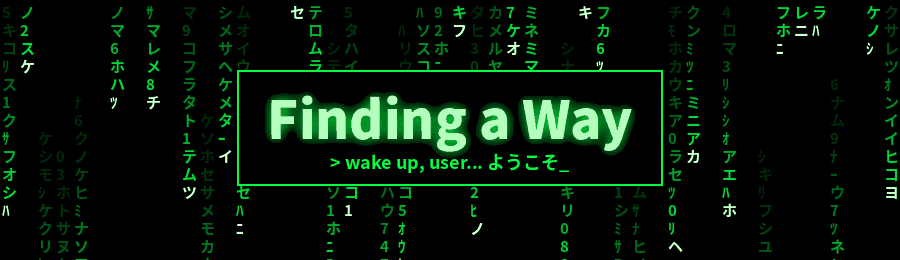

<!-- Матричный дождь: загрузи matrix.gif в этот же репозиторий -->
<p align="center">
  
</p>

<h2 align="center">⟦ Hi there, I'm ⟧</h2>

<p align="center">
  <code>> 1_Xaker</code><br>
  <code>> Fail</code><br>
  <code>> Finding a Way</code>
</p>

<!-- Печатающийся текст в стиле терминала -->
<p align="center">
  
</p>

<p align="center">
  <a href="https://discord.com/users/402465389277347861"></a>
  
</p>

<p align="center"><code>░▒▓█ クリシュナ ・ バガヴァッド・ギーター █▓▒░</code></p>

## ▓ About Me 〜 自己紹介

```bash
$ whoami
> IT student based in Czechia
> interested in Linux, computer networks and DevOps
> in free time — making games in Claude Code
```

- 🖥 **Current Focus** — Learning Linux administration and networking.
- ⚡ **Interests** — Game development, self-hosting, automation.
- 🎮 **Project** — my own game made in Claude Code.

<p align="center"><code>░▒▓█ クリシュナ ・ バガヴァッド・ギーター █▓▒░</code></p>

## ▓ Tech Stack 〜 技術

<p align="center">
  
  
  
  
</p>

<p align="center">
  
  
</p>

<p align="center">
  
  
  
  
</p>

<p align="center"><code>░▒▓█ クリシュナ ・ バガヴァッド・ギーター █▓▒░</code></p>

## ▓ Languages 〜 言語

<p align="center">
  
  
  
  
</p>

<p align="center"><code>„Not all those who wander are lost“ 〜 (⌐■_■)</code></p>

<!-- Нижняя полоса -->

